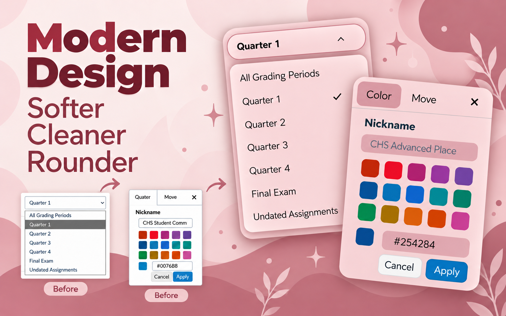
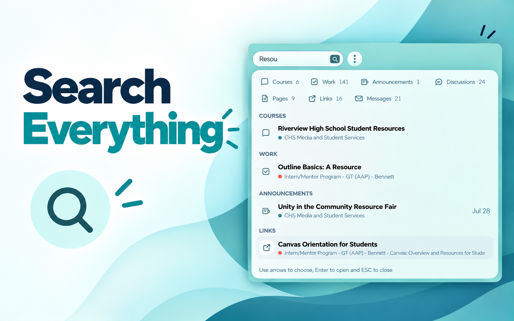
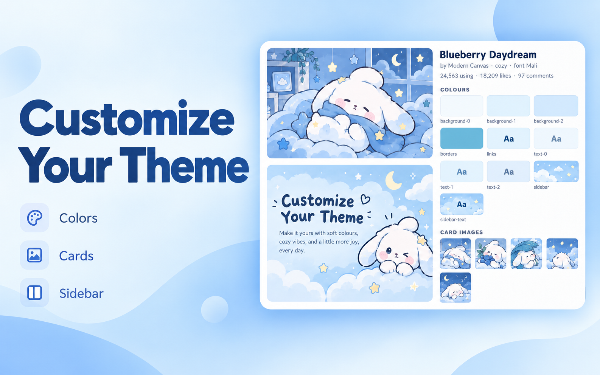
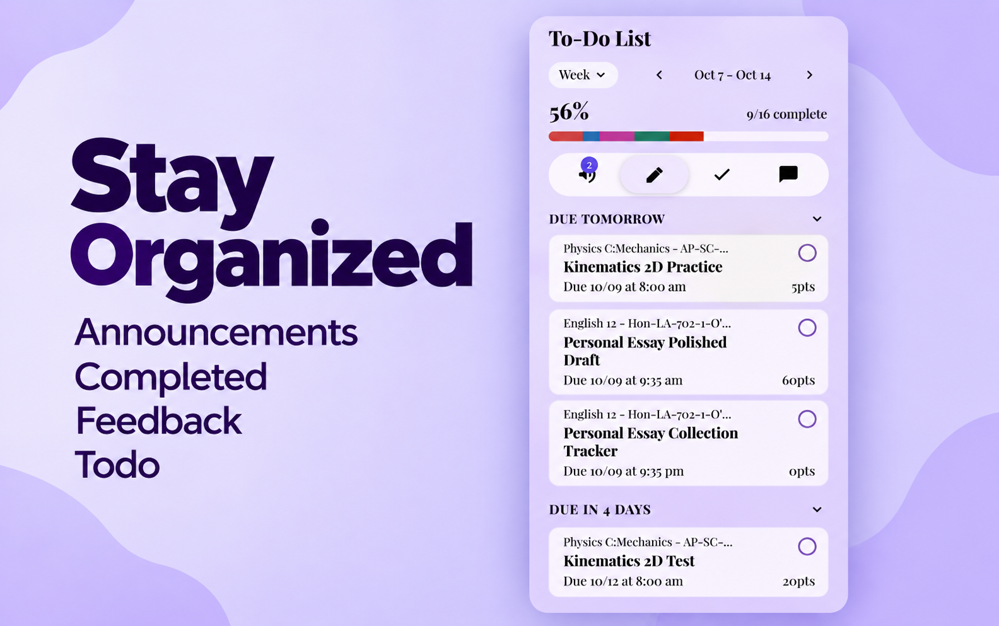

# Modern Canvas

### 👉 **[[TRY IT OUT HERE] Chrome Web Store](https://chromewebstore.google.com/detail/modern-canvas/nimjidnmlhmaakgoicmcalchongokmbk)** 👈

[English](README_EN.md) | [中文](README.md)

---

## 🎨 视觉预览与真实截图

说实话，我其实不太想写那些长篇大论的 Feature List 列表了……所以直接让 AI 帮忙做了几张图。

**所有图里的界面、排版、交互和功能都是 100% 真实截取的！** 欢迎大家直接去安装体验，感受最直观的现代 Canvas 学习体验。

### 🌟 Design & Aesthetic

### 📬 Inbox & Smart Triage

### 🔍 Search & Quick Navigation

### 🎨 Custom Themes & Dark Mode

### ✅ Todo & Assignment Focus

---

## 🤖 内置 AI 功能与使用场景

Modern Canvas 深度整合了智能学习工作流，针对 Canvas 常见痛点提供了专属 AI 入口：

### 1. 📬 Inbox AI Reply (智能邮件回复)
- 直接在 Canvas Inbox 对话框中根据上下文起草邮件、回复老师。
- ⚠️ **血泪教训警告**：千万不要随便选 **Playful (调皮/开玩笑)** 语气！  
  *真实测试翻车现场：* 我在测试这个功能的时候手滑选了 Playful 调戏语气，一不小心真发给了老师……吓得我第二天一大早跑去跟老师拼命道歉，还好老师知道我是在做插件开发测试哈哈哈哈哈哈哈哈哈！**给老师发信请务必保持 Professional 严肃语气！**

### 2. 📝 Assignment Guide (作业拆解与指导)
- **智能难度评估**：程序会首先自动分析你的作业难度与复杂度，并结合评估分值，智能决定是否需要唤起 AI 辅助，避免浪费 Token 和过度打扰。
- **解析要求与 Rubric 评分表**：深度解析作业详细要求与 Rubric 评分标准，针对性生成清晰的拆解建议、得分关键要点与逐步行动清单（Actionable Checklist），帮你把大作业一步步轻松拿下。

### 3. 🧠 Study & Retrieval Assistant (学习与检索助手)
- **课件与资料理解**：支持将老师分发的课程文件、PDF、讲义输入给 AI，快速提炼核心概念、归纳重点。
- **联动 Task 定制练习**：结合你当前待办任务与考试安排，自动为你生成高价值的 **Cheat Sheet (复习速查表)** 或 **针对性练习题/模拟题**，高效备考复习。

---

## 🔑 AI Key 与套餐方案

你可以自由选择最契合自己的 AI 接入方式：

- **BYOK (Bring Your Own Key)**：支持在插件设置中直接填入你自己的 API Key，免费且自由使用。
- **Flexible Paid Plans (开箱即用付费方案)**：不想自己折腾 API Key、海外信用卡或担心额度的话，也可以直接选择我们提供的付费套餐，一键解锁所有功能。
- 🔒 **数据与隐私**：界面设置主要在本地处理。可选 AI 功能会在获得分享许可后，把所选材料发送到你配置的提供商，或经 Modern Canvas 网关转发至 OpenRouter 与模型提供商。本地会话、账号/套餐记录和主动提交的反馈会按隐私政策保存；下游服务适用其各自的数据使用与保留政策。

---

## 📦 本地手动安装（测试/开发版）

如果你不想从应用商店安装，也可以直接通过 Zip 压缩包离线安装：

1. 点击本仓库右上角绿色的 **Code** 按钮，选择 **Download ZIP**（或直接在 [Releases](https://github.com/lingqi0001/Modern-Canvas/releases) 页面下载最新版本的 `.zip` 包）。
2. 将下载的 ZIP 压缩包解压到本地任意文件夹（例如解压到桌面）。
3. 打开 Chrome 浏览器，在地址栏输入并访问 `chrome://extensions/`。
4. 打开右上角的 **开发者模式 (Developer mode)** 开关。
5. 点击左上角的 **加载已解压的扩展程序 (Load unpacked)**，选择刚刚解压出来的文件夹即可完成安装！

---

## 📄 License (开源许可证)

Modern Canvas 采用 **PolyForm Perimeter License 1.0.0** 源码可用（Source-available）许可证。

- 欢迎浏览源码、学习交流并提交非商业性质的改进与 PR。
- **严禁**利用本项目源码开发、分发或提供与本项目构成竞争关系的产品或服务。
- 如有商业授权或定制部署需求，请联系项目维护者。
- 项目中使用的第三方开源组件均遵循其各自的开源许可协议。

完整条款详见 [LICENSE](LICENSE) 文件。
